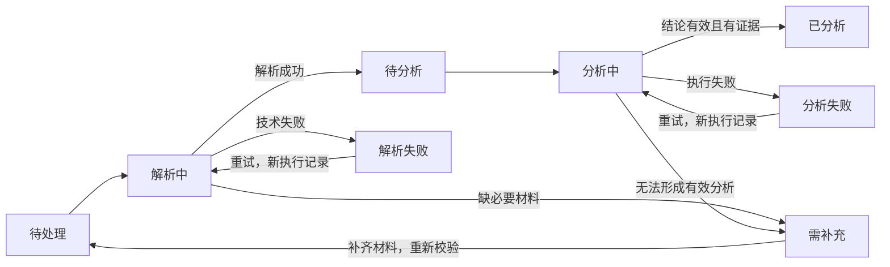
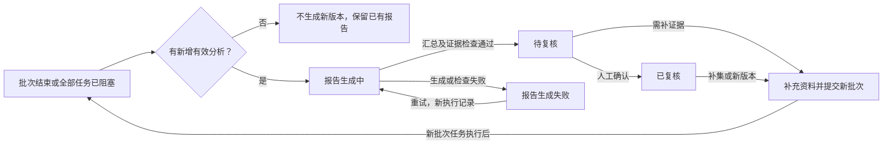

跪呈南哥批阅：

# 研判室模块交互说明

版本：v0.22｜日期：2026-10-17｜状态：已沉淀业务差异、作品组织、输入与分析流程、市场预测及审核闭环；页面与交互严格按Demo，未覆盖字段与评分阈值待细化。

总纲：[AI知识库产品需求文档_PRD.md](../AI知识库产品需求文档_PRD.md)。本文承接本模块需求与交互细节；跨模块边界、权限共用规则、阶段范围及整体验收以总纲为准。本次讨论明确“综合判断同时包含AI质量评级与市场数据预测”，下文已同步调整F-10，不能沿用旧版“仅人工预测登记、AI辅助可选”的实现口径。具体评分阈值、平台支持与预测可靠性仍需验证。

本模块全部工作区删除二级导航下方的页面引导说明及其占位；保留必要的新增／提交等操作按钮，无操作时不留空行。共用视觉规则见[DESIGN](../DESIGN.md)。

**前端开发基准（2026-10-15用户确认）：本模块必须严格按[当前Demo](../prototypes/index.html#2/0)已呈现的页面和交互开发。** 覆盖布局、视觉、字段与操作、校验、状态、跳转和返回；旧文档、历史截图或待审批图册与Demo冲突时，以经用户确认的Demo为准。不得擅自改版，交互变更须经用户确认并同步；具体纪律见[AGENTS](../../AGENTS.md)。本文补充业务语义和真实服务要求，演示数据、本地模拟和未接入能力不能充当正式实现；未展示的交互另行确认。

## 一、定位与已确认流程

共用研判流程，按AI漫剧、故事短片、电商短视频切换知识结构、拆解模板与评价标准。以作品组织研究资料，输出内容分析、质量评级与市场表现预测，可提炼候选知识；通过发布后的实绩复盘与独立验证持续改进标准。

内容入口：情报局转入待研判、自主上传、粘贴信息链接，并兼容手工输入文本。统一流程为 `接收资料 → 解析与预览 → 确认业务、作品归属及材料类型 → 人工初评 → AI分析与综合判断 → 用户复核 → 选取候选知识 → AI与人工审核 → 藏经阁`。情报局已有初评直接带入，不要求重复填写；解析不足先补充材料。

评价本身可独立完成，不强制提炼知识；低质量内容也可能形成失败案例或禁忌经验。独立评价无需项目或生产器接口，正式内容修改在外部工具完成。

发布闭环为 `发布前预测留档 → 登记外部发布 → 自动采集／人工补录实绩 → 对账复盘 → 候选规律／标准 → 验证审核`。综合判断提供市场预测区，但不强制每份资料都具备可量化预测；没有事前预测的案例仍可复盘，不纳入盲预测校准。

## 二、模块交接

情报局的主观标记是研究输入，研判室输出详细评价与候选知识，藏经阁承接正式知识的审核发布和维护。Rubric配置归控制台，升级研究与验证归研判室，使用同一标准版本对象。

知识审核的具体操作页面与研判结果回显方式仍待共同确定；情报流的重复提交规则见下文。抓取不到正文时不得只根据链接标题给出完整分析结论。

## 三、现有需求定义

**F-11 来源与加工。** 支持自主上传视频、剧本、故事文本、小说文本，手工输入，以及控制台配置的定向监测源。候选来源包括博主主页、作品详情、笔记详情、答案详情等；具体平台与页面类型需通过连接器试接确定支持清单，不默认所有网址都能抓取。

S05.3实现边界：共用文件服务已支持文本、PDF、MP4与PNG／JPEG接收、基础格式校验及实时授权下载；文件先绑定Work，正式ArtifactVersion只能引用同作品文件，历史下载按精确版本file_id。外链仅接受显式可信HTTPS直接素材，普通平台分享页交后续连接器；上传成功不代表全文／全片解析或AI分析完成。当前Demo上传交互未改、尚未接这些真实请求，详见[文件存储与访问](../technical/文件存储与访问.md)。

保留原始资料版本、来源URL或文件标识、采集时间及可使用范围。按格式调用转写、文字识别、关键帧或文本分段，再按资料类型拆解知识；支持范围与处理状态可见。解析失败不自动产出可用知识，用户可重试或补充资料。同一原始素材支持复用，不因“选题用”和“入库用”重复保存。

**F-20 轻量内容档案。** 内容可来自情报局“待研判”、用户自主上传或粘贴链接，包含选题、脚本、图片／资产或成片，无需创建项目。系统以作品组织单集／片段及材料版本，保存稳定ID、业务线、对象类型、内容版本、文件／文本引用及必要参考，关联前序选题或内容、评价、预测和发布。允许只评价、不发布，也允许历史已发布内容直接复盘。作品容器只服务研究，不扩展为创作编辑器、排期或项目工作台；具体组织见第四章。

**F-08 版本化评价标准。** 按业务、环节、对象类型配置维度、评分说明、权重、硬性不通过项及适用条件。研判室选择使用，控制台编辑与发布；升级候选从研判室进入验证审核流程。首期需要配置匹配业务样本的标准，不采用万能“爆款总分”。

**F-09 AI评价与人工复核。** 对固定内容版本执行AI评价，保存分项结果、证据位置、问题、标准版本及模型执行记录。用户可确认、反驳或覆核并说明原因，原结果保留。脚本、资产、成片修改在外部完成，再上传新版本复评；跨版本报告可比较，但须显示标准是否一致。

缺少角色参考、商品事实或其他必要输入时，相关维度返回“证据不足”，不是零分或自动合格。硬规则失败单列，不被平均高分抵消。评价意见属于分析，不直接生成正式改写稿、图片或视频。

**F-10 市场表现预测与发布前留档。** 综合判断必须包含AI内容质量评级和市场表现预测两个独立部分；市场预测不能以SABC评级或笼统“有爆款潜力”替代。对具备必要条件的内容，输出具体市场指标的预测区间、依据与不确定性；条件不足明确标为“暂不可可靠预测”。同时保留人工预测登记，人工与AI结果分别保存。预测绑定作品／单集、材料版本、平台、账号、投放等发布条件、指标定义、观察窗口、所用标准／模型／提示词版本及执行者。

预测冻结使用服务端真实留档时间；冻结后不可覆盖，撤销追加记录。发布后补录不能成为合格盲预测，作品改变需新判断。不预设模型已具备校准后的预测能力，不虚构精确数值或置信度；样本与条件不足须明确显示。资产主要评质量，市场结果关联最终发布作品。早期选题或脚本的条件性预测可保留为决策依据，不能直接冒充最终成片版本的发布前预测。

**F-15 发布登记与实绩导入。** 用户登记外部链接、平台、账号、发布时间和内容版本；系统按已支持的平台能力自动采集实绩，并支持手工录入或文件导入。指标保存定义、数值、统计窗口、来源和修订；一个内容可多次发布，不能按标题自动合并。缺关联数据进入待关联区，未知与零值分开。首期不依赖生产生成记录回传。

**F-16 对账与复盘。** AI辅助整理预测与结果差异，用户查看证据并形成复盘。对比限定同内容版本、同发布条件、同指标及窗口；同时记录账号、分发、投放等因素，证据不足时只形成观察。无事前预测、预测版本不匹配或发布后补录的内容仍可复盘，但不进入合格盲预测校准样本。

**F-17 候选知识与标准调整。** 内容研判或发布复盘均可产生知识草稿、方法假设或Rubric候选版本，不自动修改已发布知识与标准。普通事实变更通过来源核实与审核；声称改善效果的方法、权重与标准须进入验证。

**F-18 验证、审核与生效。** 保存样本范围、时间、指标、新旧版本结果及决策依据，区分调参样本与验证样本，优先按时间留出样本。样本不足保留候选；通过审核才生效，支持停用和回退。新评价使用生效标准，历史报告继续引用旧版本；知识候选进入藏经阁审核链，标准候选进入同一Rubric版本库。

## 四、业务组织与交互结论

### 1、工作区与业务分析结构

保留“内容研判、发布复盘、规律验证”三个二级入口，业务范围统一沿用顶部“业务空间”单选，模块页面不重复提供业务选择。内容任务、发布记录、候选规律及可关联内容版本均属于当前业务；无对应数据时显示空态。内容研判页的“新建研判”操作位于左上方，与情报局选题操作对齐（2026-10-10确认）。新建研判默认当前业务，对象编辑仍可校正业务；修正为其他业务后，用户通过顶部切换空间查看该记录。共用任务、证据、评价、预测和审核能力，按业务切换分析模板、资料组织与展示结构；不另建三套互不关联的系统。业务线之外还须识别选题、剧本、图片／资产、成片等材料类型，不拿成片标准评价仅有文字的资料。

| 业务 | 组织单位 | 分析内容与交互重点 |
| --- | --- | --- |
| AI漫剧 | 一部作品包含多集，每集有材料及版本 | 全剧分析题材、人群、核心设定、人物关系、世界观、主线、情绪与爽点、金句、伏笔回收；单集分析冲突推进、节奏、钩子与视听表达，支持全剧／单集切换 |
| 故事短片 | 一部作品通常对应一个视频，可关联前期文本与其他版本 | 一句话故事、主题与情绪、人物目标与阻碍、结构转折、信息揭示、镜头与声音、节奏、结尾回收；围绕单部作品及时间段阅读证据 |
| 电商短视频 | 一条作品关联商品，可包含多个创意版本 | 目标人群、使用场景、痛点、卖点与证据、开场吸引、演示说服、异议消除、行动引导；结合商品资料核对表达与依据 |

以上为已讨论的分析结构方向，维度权重与SABC等级边界仍待细化。用户截图中的人物、世界观、钩子、节奏等可作为分析维度参考；“锁定、生成、跳过”等生产节点操作不照搬。AI只提取材料中实际存在的内容，缺项标明“未发现／材料不足”，不补写不存在的剧情或镜头。

### 2、作品、单集与材料版本

概念关系为 `作品 → 单集／片段 → 选题、剧本、视频等材料及版本`；整部作品级资料可直接关联作品，短片界面无需强制展示“第1集”。这是研究资料的组织关系，不预设数据库表结构，也不要求用户先创建生产项目。

漫剧支持批量上传、集数排序、补集及关联已有作品。作品列表展示已收集／已分析集数与材料覆盖范围；总集数未知时明确标注，不能假装收集完整。详情可切换“全剧概览／单集分析”，结论能定位原视频时间点或文本段落。

2026-10-12确认：内容研判页移除“适用环节”选择，以作品为一条长卡片，展示名称、编号、题材、资料覆盖、最近分析、状态及操作。状态筛选及计数以作品为单位；多集、多版本研判按稳定作品ID归入作品详情，不按相似标题自动合并。缩略图优先使用作品封面；封面缺失或加载失败时使用视频帧，有可访问的视频文件时可截帧；图片及视频均不可用才回退首字。已有报告的“查看报告”使用红色强调按钮，其他操作沿用普通样式。

2026-10-12补充确认：搜索行增加作品题材单选，选项来自当前业务作品的题材标签，默认全部题材；与状态、关键词同时生效。综合搜索支持作品名称、作品编号、博主ID及名称，读取作品与来源快照的实际账号字段，不以内部监测配置ID代替博主ID；切换业务或页面时清空局部筛选。Demo提供两张生成封面和一张模拟视频截图用于展示测试，非真实作品采集素材，旧样例缺失的图片及演示账号字段自动补入，不覆盖已有值。

仅有部分集数时只能给出覆盖这些材料的局部结论；全剧质量评级不简单平均单集评分，全剧与单集市场预测也不能简单相加。补充资料或更换版本后形成对应的新分析，历史结论保留其材料范围。来源、作品、单集、材料版本及平台发布记录分别关联，不以相似标题自动合并。

**2026-10-14页面构成确认与Demo调整。** 作品列表仍用长条卡片，汇总封面、作品名／编号、题材、博主ID、资料覆盖、处理进度及最新报告。点击卡片进入完整作品详情页，不再打开作品抽屉；“查看报告”直达该作品的作品分析区，补充资料始终关联当前作品。报告与任务状态分开展示：运行、失败和既有阶段报告可同时存在。列表筛选为全部、处理中、需处理、待复核、已有报告，可交叉命中，不把筛选计数求和当作品总数。

2026-10-15补充：进入作品详情时，左上面包屑显示“研判室 › 内容研判 › 作品名”。前两级使用可键盘访问的链接，研判室返回模块默认入口（当前为内容研判），内容研判返回作品列表并保留同工作区筛选；作品名为当前页标识，支持长标题省略及完整标题提示。切换详情分区、刷新与浏览器后退时同步更新，返回列表不残留作品名。

作品详情顶部展示身份、总集数、已收集／已分析、处理及报告概况；下方为“作品分析／分集分析／资料与记录”三个页签，漫剧默认分集分析，其他业务显示“内容分析”，不强制第1集。分集区左侧按实际集号排列，支持集数／标题／材料编号搜索及当前状态筛选；未标集资料单列，不根据标题、列表顺序或历史汇总数量补造集号。右侧显示当前材料／执行记录，可切换历史版本；原始内容、来源、人工初评、观众反馈、拆解、原文证据及候选知识依次呈现。旧分析和新版处理状态可同时显示。作品级分析包含核心设定、人物关系、主线、世界观、跨集节奏、伏笔、质量判断与独立市场预测；跨集证据可跳到对应单集和材料版本。

**2026-10-15分集导航、作品文档与基础数据更新。** 漫剧分集导航每集一行，仅显示集序号和集标题；有材料用正文色，未收集用辅助色，选中项另有底色及当前项语义，不只依赖颜色。总集数已知时列出全部集号，缺集可选并展示空态、直接补充该集资料；总集数未知时只展开已知集号范围，旧未标集资料单列，不从历史汇总数字猜集号。未知标题显示“标题未获取”；长剧每100集一段，支持输入集号跨段查找，分段与选集可随链接恢复。

2026-10-15后续调整：取消分集导航搜索框和状态下拉菜单，同时移除隐藏的搜索／状态筛选；导航只保留集序号、标题及长剧分段按钮。选集、缺集空态、补集、历史版本和证据跳转保持可用。此决定替代本节前述按集号／标题搜索与状态筛选的展示规则。

作品分析调整为一个连续、只读的格式化文档，按Markdown式标题层级展示，不为各方面单独套文本框。固定十部分为：0作品优缺点、1故事大纲、2情绪与母题、3人物设计、4世界观与长线悬念、5情节与冲突、6节奏结构、7终局设计、8剧情发展高潮曲线、9观众评论反馈总结。每部分分别给出事实分析与改写建议，已有证据可跳转单集。暂无报告也展示同一框架，标为待分析，不生成虚假结论；未覆盖结局不能判断终局，评论缺失明确说明。高潮曲线仅绘制报告覆盖范围内已有点位，缺数据不画线；Demo的叙事强度为固定演示，不是市场指标或观众评分。人工初评、评价／预测和候选审核作为同一文档的附录保留，旧报告正文兼容映射，不覆盖用户已有分析。

作品顶部原有四个概况块之外增加总观看量、互动量，读取独立表现快照及其统计范围、平台和采集时间，不累加多个累计快照，不用单集情报数值冒充整部作品总量。未获取数值视觉留空，辅助语义为未获取；真实0正常显示。互动量有明确总数时读取总数，只有赞／评／转／藏四项齐全时才可求和，缺一项不拼成总量。多集演示作品补充明确标记的虚构表现快照，其覆盖55集不随补集自动扩大。

作品分析读取独立报告版本及实际覆盖集号，补集、重试不自动扩大旧报告范围；既有任务级报告按材料报告兼容展示，未知集号不能冒充全剧报告。资料与记录汇集作品级材料、提交批次／执行记录、历史报告。补资料可选作品级或单集级，单集须填写合法集号；同集补资料创建新材料版本，不重复计算集数。失败重试保存新执行记录，旧结果与人工初评保留，Demo仅记录待处理／待分析请求。

两层均区分分析发现、候选知识与已审核入库知识。提交候选保留作品／报告或材料引用以及跨集证据，进入待AI审核，不自动入库。Hash链接保存作品、页签、选集及材料／报告版本，支持刷新与后退；返回作品列表保留原筛选，切换业务退出原作品，失效或跨业务链接显示明确空态。

Demo新增“逆风归城 · 多集演示”：总80集、实际列出55集，其中40集已分析、10集分析中、5集解析失败；预置三个独立阶段报告分别覆盖10、25、40集。封面复用生成样例，正文、分析、时间点及报告均为固定演示内容，非真实采集或AI结果。旧样例不按聚合数字自动展开虚构分集，历史统计标明含历史汇总；新增样例只补缺失ID，不覆盖用户修改。真实任务执行及按批次生成／增量汇总报告仍未接入。

**2026-10-13状态机更新。** 已确认原则：漫剧作品按各集／材料版本汇总多种状态；解析完成不等于有效分析完成；报告按提交批次生成和增量更新，保留历史覆盖范围与版本。下述完整任务与报告状态机仍为设计方案；作品汇总、详情、旧报告阅读及本地补资料／重试入口已展示，自动执行与报告生成尚未接入。

**单集／材料任务状态。** 每次任务绑定作品、集数、材料版本、分析标准；新版本及重跑保存新执行记录，不覆盖旧结果。资料获取、转写、解析归资料处理阶段；排队在相应阶段显示。已有可复用的解析资料可以直接进入待分析。

未运行任务可取消，执行中任务须确认停止后才标为已取消；重新发起保存新任务。失败、需补充和已取消均不得计为已分析。部分维度证据不足但仍有有效结论，可以进入已分析，缺项标在结果中；只有核心材料不足、无法形成有效分析时阻塞为需补充。

**批次与报告版本状态。** 同一提交批次内所有任务进入已分析、失败、需补充或已取消等结束／阻塞状态后，检查是否存在至少一集有效分析，以及本批次是否提供新的有效结果。正在排队或处理中不算批次结束。单次提交只有一集时，该集有效分析结束即可生成首份阶段报告；提交十集时在十集均结束或阻塞后统一汇总。失败及缺项不无限阻塞成功集的局部报告；全部失败／没有新有效分析时不生成新报告，保留已有报告并提示原因。

新批次仍经过上述单集流程，图中H到A省略执行阶段。报告v1／v2独立保存覆盖集数、材料版本、缺失和失败范围、标准版本与复核记录；新版本待复核不覆盖旧版已复核状态。最新报告入口更新，同时旧报告始终可查看。补集需重新汇总跨集人物、主线与伏笔，不只追加摘要；同一批次重复通知不重复生成版本，交错批次的较早结果不能覆盖较新材料的报告。报告生成中／失败时仍可查看已有报告。

阶段报告只对实际覆盖材料下结论。确认总集数并达到全剧判断所必需的材料与分析覆盖，才可标为全剧报告；已知80集、分析30集仍是阶段报告。总集数未知不能宣称全剧完成。全剧报告不代表所有维度都可评价或可靠预测，更不代表候选知识已完成双审入库。

**作品列表为汇总视图，不套单一任务状态。** 并列显示总集数、已收集／未收集、已解析、解析中／失败，以及已分析、分析中／失败、需补充等数量。各阶段分别统计当前材料的唯一集数，不按重试次数累加，不把已解析数量当已分析数量，跨阶段计数不能直接相加。作品“处理中”“需处理”“待复核”等筛选可交叉命中，各筛选内按作品去重，筛选计数之和不代表作品总数。报告状态单列，作品已复核报告与正在处理的新集可同时存在；不使用最近一条任务替代整部作品汇总。

| 条件（可同时成立） | 右侧主要操作 | 报告入口 |
| --- | --- | --- |
| 有待处理／待分析任务 | 开始处理／分析；已排队时查看进度 | 有已有报告则保留 |
| 有解析／分析运行任务 | 查看进度 | 查看已有报告 |
| 有失败任务 | 重试失败项，分别重试解析／分析 | 查看已有报告 |
| 有核心材料缺失 | 补充资料 | 可查看已有局部报告及缺项 |
| 报告生成中 | 查看报告生成进度 | 查看已有报告 |
| 报告生成失败 | 重试生成报告 | 查看已有报告 |
| 最新报告待复核 | 复核报告 | 查看最新报告及历史已复核报告 |
| 最新报告已复核 | 查看报告 | 补集／新版本后可重新研判 |

作品标题统一进入作品详情；右侧按当前条件组合按钮，常用操作直接显示，取消和其他操作放更多菜单。报告／复核入口沿用强调色。同一作品同时有处理中与失败任务时显示两项及其数量，提供查看进度、重试失败项与已有报告入口；不以单一状态遮蔽另一项。

### 3、输入来源与人工初评

情报流提交时同时保留所选日期的观众反馈快照（2026-10-09确认）：包含情绪分布与触发原因、作品反馈、观众期待、创作建议及支持评论。用户选择研判后，人工初评抽屉与研判任务详情可展开查看关键反馈及完整观众反馈；关键反馈句不放在情报列表或普通反馈抽屉中。提交后保存独立副本，后续采集不覆盖；旧任务没有反馈时不补用当前评论。该反馈属于已有表现的案例证据，不自动替代质量评价或用于事前盲预测，不直接发布为已验证规律。原型全部评论及归纳均为虚构演示，正式分析模型和采样策略尚未接入。

| 来源 | 提交与处理 |
| --- | --- |
| 情报局榜单／达人内容 | 点击“研判”，保留来源与数据快照，带入人工初评后进入待分析流程；复用已有资料，必要时补充解析 |
| 用户粘贴链接 | 解析链接取得内容并预览，确认业务、作品归属及材料类型，人工评级与评价后提交分析 |
| 用户上传文件／输入文本 | 解析视频、剧本、选题等资料，确认归属；多集资料整理顺序后人工初评，再进入分析 |

人工初评记录S／A／B／C、评价或具体学习点，复用已有预置学习点标签。评级明确采用内容质量口径；研究价值和已知市场表现另列，不能用同一个等级兼指三者。材料不足不得强行填写低等级，应提示补充；具体必填规则待细化。

AI首次质量评级不读取用户初评等级和倾向性评价，使用原始材料及有效标准独立判断；用户校正的业务、题材及事实信息可作为输入。独立结果生成后再展示人机分歧并复核，原始人工意见与AI结果分别留档，避免将迎合人工意见当成评价有效性。

**情报流既有抽屉交互保留：**

用户在情报流点击单条榜单或达人视频的“研判”，右侧抽屉显示标题、剧情、来源、业务及题材、赞／评／转／藏快照，四个指标框内的名称与数字作为一组横向、纵向居中。用户提交 S／A／B／C 人工评级，修正研判使用的业务及题材标签，并选择预置学习点标签或写出具体学习点。人工初判与后续AI评价分开保存；修正标签保存在研判记录，不覆盖原始采集标签。提交时保留来源ID与互动数据快照，任务状态在研判室显示为“待分析”，情报流继续停留原页。

2026-10-14更新：情报流提交漫剧研判支持作品名称建议、人工改选或输入新名称建档；正式服务由AI根据采集证据提出建议，Demo仅模拟来源关联和唯一名称线索匹配。已有作品按用户选定的稳定ID关联，原视频标题不覆盖，同名歧义须选择具体候选。选填总集数和当前第几集，当前集数不超过已知总集数；总集数保存到作品，当前集数保存到材料／任务，两项及作品名称保存在本次初评快照，历史值不覆盖。作品详情回显当前集数，集数序号不当作已收集数量。新来源归入已有作品时增加资料计数，同来源重复提交不重复增加。只有AI漫剧使用上述字段。

2026-10-14确认：作品详情及作品报告展示情报流提交的人工初评，包括人工评级、业务／题材修正、学习点标签、补充学习点、来源、情报日期、材料版本与提交时间；没有记录明确显示尚无初评，不补造评级。作品详情按稳定作品ID汇总关联材料的初评，报告区分本次材料初评与其他关联初评，不将多集或不同版本的判断合并成全剧评级。后续关联记录独立展示，不冒充历史报告的原输入或修改旧结论。重复提交待分析任务追加初评快照，最新初评默认展开，旧提交通过历史初评展开查看；旧存储中的既有评级与文字字段兼容显示。补充文字保留换行并按纯文本转义。AI首次独立评价仍不读取人工倾向性判断。原型仅保存与展示这些记录，未接入报告自动生成或真实AI判断。

同一来源已有待分析任务时再次提交，更新该任务并保留操作记录；已有完成报告时新建任务，旧报告不覆盖。原型仅演示待分析记录，没有真实解析或AI分析。正式接入时须补齐任务状态、权限与重复请求契约。

### 4、分析结果的四个部分

| 结果部分 | 内容与操作 |
| --- | --- |
| 内容拆解 | 按业务与材料模板组织，展示资料覆盖范围，逐项关联原始证据 |
| 综合判断 | 同时展示AI质量等级、分项判断、优势问题，以及市场指标预测区间、预测条件、依据与不确定性；可查看所用评价标准 |
| 人机分歧 | 并列人工初评与AI判断，解释主要分歧，允许用户确认或修正并保留历史 |
| 候选知识 | 用户可编辑、拆分、合并及勾选送审；每条附来源证据、适用条件、限制及可得反例 |

这四部分属于报告内部结构，不新增模块级二级入口。每项结论关联对应内容及标准版本；质量材料不足显示“暂不可评”，不直接判C。知识条目区分“该作品采用了某种手法”的案例观察与“某种手法在特定条件下有效”的方法假设，后者须补充验证证据。

**综合判断中的市场预测：**

- 基础指标包括播放、点赞、评论、转发、收藏；电商在数据基础允许时补充点击与转化指标。每项记录计数或比率的定义、单位及观察窗口，不把缺失指标当作零。
- 用户指定或确认平台、账号、投放等发布条件；预测优先输出数值区间、依据与不确定性。必要条件、可比样本或指标基础不足时显示“暂不可可靠预测”及缺项，不以SABC或任意数值补位。
- 漫剧区分单集预测与整部作品预测，明确所覆盖的集数及发布安排；全剧指标的汇总口径需另行定义。短片按作品对应的发布版本预测。
- 预测留档绑定作品／单集、内容版本、评价标准和预测时间。发布后在同口径下展示“预测值—实际值—偏差”，不能用较晚累计数替代目标窗口的数据。
- 分析已发布的外部案例，若已看到市场表现则属于事后分析，不纳入发布前预测准确性验证；不能仅隐藏界面上的数据就宣称完成了盲预测。

### 5、标准展示、审核与学习闭环

第一版评价标准来自专家经验与人工标注案例。人工SABC和评价、人机分歧、AI内容分析及发布实绩共同提供修订线索，不能把人工高分或高播放直接视为标准答案；同时考虑账号、分发与投放等条件。

研判报告可查看当前采用标准的维度、等级说明、适用业务／材料范围及版本。“规律验证”展示修订理由、新旧标准差异、独立样本验证结果和候选状态；不能用同一批样本既修改标准又证明其有效。验证与人工审核通过后，正式版本进入控制台共用标准库；新分析使用生效版本，历史报告保持原标准引用。

分析结果经过AI审核和人工复核：AI检查证据支撑、完整性、重复与冲突，人工决定是否采纳。报告可以留在研判室，用户选中的候选知识经双审后才进入藏经阁；完整报告确有保存价值时可作为案例型知识送审，不强制所有报告全部入库。

研判室与藏经阁共用审核对象和记录，同一版本已完成的同类审核可复用，不因换入口重复操作；实质修改须针对新版本重新审核。报告复核不自动等于其中所有知识条目均已批准，候选条目的正式入库状态必须明确。

## 五、局部验收与待讨论事项

### 1、局部验收要点

2026-10-14补充：验证整卡／键盘进入完整页面、稀疏集号、多版本与重试去重、状态筛选后的版本操作、初评回读、旧报告固定覆盖与证据跳转、候选送审、补资料校验、刷新／后退及业务隔离。语法与Node隔离行为检查通过；未完成浏览器实屏布局／实际点击滚动验收，真实AI、采集和解析未验证。

1. 三种来源均能进入同一分析流程，情报局初评无需重填；人工初评与AI独立评级分开保存，解析失败或材料缺失可识别。
2. 漫剧可按作品管理多集、批量导入和补集，显示覆盖范围及全剧／单集结论；部分集数不冒充全剧分析，短片无需额外创建可见单集。
3. 报告包含内容拆解、综合判断、人机分歧、候选知识；分析结构随业务及材料类型匹配，结论可定位证据。
4. 综合判断同时展示质量评级与市场预测；具备条件时提供具体指标区间，条件不足时明确缺项。冻结预测绑定版本与观察窗口，事后分析不混入盲预测样本，发布后可对照实绩查看偏差。
5. 候选知识通过AI与人工审核后入库，报告可独立留存；标准修订经独立验证和人工批准生效，历史报告和预测不被改写。

### 2、仍待细化

1. 三个工作区的具体布局、报告目录与证据联动，任务进度、失败重试及研究结果回显；状态说明见第四章第2节；Demo已有按钮布局按Demo执行，未覆盖行为继续细化。
2. 各业务及材料类型的字段、评级维度与SABC边界，人工初评必填项、材料不足处理和复核权限。
3. 支持的平台、链接及文件格式，作品匹配、集数识别、批量上传、重复材料与补集后的重分析规则。
4. 预测指标定义、观察窗口、必要发布条件、可量化预测的数据门槛，以及漫剧全剧汇总口径、验证方法和样本要求。
5. 候选知识编辑与送审界面、案例型报告入库规则、版本变更后的复核范围；这些细节与藏经阁共同确定。

2026-10-17 S07.1：S07.1已建立六类AI任务定义与schema，当前仅做既有简介的局部拆解验证，不创建正式作品或报告。评级边界未批准、预测未校准时返回证据不足；全剧覆盖、视听解析与报告入口仍按S07.2／S07.3接入。 详见[AI任务定义](../technical/AI任务定义.md)与[执行记录](../plans/2026-10-17-S07.1任务定义与模型验证.md)。

2026-10-17 S07.4：作品分析的“作品级知识提炼与审核记录”附录已按确切报告ID接真实候选／正式知识及审核记录；提炼仍为独立显式预算任务，不把分析完成等同于知识发布。评价人工确认／反驳追加独立决定，AI原评级／维度不覆盖。当前真实模型效果后验，无新增付费调用，详见[S07.4记录](../plans/2026-10-17-S07.4知识双审与发布.md)。

2026-10-17 S07.5：报告知识附录复用藏经阁确切修订来源组件；解析证据从原始资料parent_artifact_version_id定位材料，单集编号取材料版本覆盖快照。原文路由沿用既有work／episode／artifactVersion／paragraph路径，不另建报告、评价或AI审核；来源实时撤权沿用共用Authorizer。
