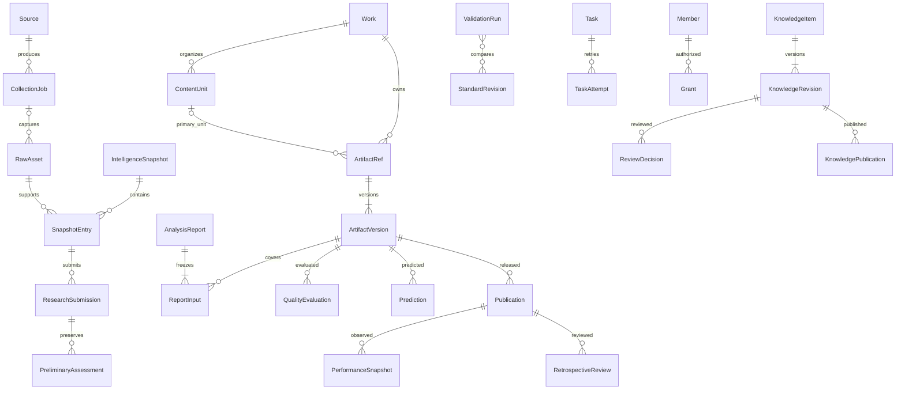

# 数据字典与对象关系

当前增量（2026-10-21）：head=0019_hongguo_reparse，仍76表（72业务＋4公共服务）；0018新增hongguo平台，0019补精确零HTTP重解析约束，全局配置现为3业务＋4平台。0014冻结解析来源，0015新增fanqie／qidian平台代码。小说观测JSON字段与不混用人数指标见[字段分册](数据字典-首批字段.md)及[小说接入](小说榜单接入.md)。0015降级仅由迁移所有者暂关platforms的不可变删除触发器，外键仍生效；已有小说引用时会拒绝降级，不先删除业务证据。以下为历史阶段记录。

版本：v0.15｜日期：2026-10-21｜适用范围：S03.1对象关系、S03.2首批字段及S03.3权限／状态／并发；见[字段分册](数据字典-首批字段.md)、[权限与状态分册](数据字典-权限与状态.md)。[S03.4迁移就绪走查](数据字典-迁移就绪走查.md)已完成，B1已在S04完成70表及数据库约束验收，见[迁移记录](../plans/2026-10-16-S04模型与迁移.md)；S05.2新增3张服务表，字段、会话与回执生命周期统一见[登录权限与审计第四章](登录权限与审计.md#四增量数据字典与恢复)，不改变B1历史分组；S05.3新增[file_intakes唯一字段定义](文件存储与访问.md)，合计74表；S05.4不增表，新增[任务控制函数及运行约束](任务队列与调度.md#四增量数据库契约与验证)，revision为0007_tasks；真实业务路由按S06／S07实现。

当前增量：0012_handoffs新增封存情报交接包；0013_research新增research_submissions.handoff_id及同条目／反馈延迟守卫，兼容旧行，不新增表。**该历史阶段head=0013_research，共76表（72业务＋4公共服务）**，下文较早“当前”数字为对应阶段历史；详见[S07.2记录](../plans/2026-10-17-S07.2研判导入与解析.md)。

S06.4增量：0010_comments增加comment_evidence.username（采集时昵称，不以昵称判定身份）；0011_insight新增不可变insight_reports，引用封存feedback版本及唯一成功零外部调用任务，外键含org_id，缺失／撤权不回退其他报告。当前head=0011_insight，共75表（71业务＋4公共服务表）。字段见[首批字段分册](数据字典-首批字段.md)，真实证据见[S06.4记录](../plans/2026-10-17-S06.4观众反馈与同日洞察.md)。以下S04／S05数字为各阶段历史验收。

依据：[PRD第三章](../AI知识库产品需求文档_PRD.md)、[技术研发方案第三章](技术研发方案.md)、[研判室](../modules/研判室.md)、[藏经阁](../modules/藏经阁.md)、[控制台](../modules/控制台.md)、[采集能力与样本清单](采集能力与样本清单.md)。任务状态统一见[研发实施计划](../plans/研发实施计划.md)。本文定义后端对象，不改变Demo页面或增加业务功能；本册英文名是概念名，首批实际表名、列、默认与约束由[字段分册](数据字典-首批字段.md)维护；B2／B3仍仅为概念关系。

## 一、统一边界与身份

三条业务共用对象结构。组织是权限边界，业务线是适用范围，两者不能互相替代；业务筛选也不能代替鉴权。来源资料、业务对象、文件、任务和历史结果均须能归属权限范围。共享知识通过适用业务关联复用一个稳定条目及其版本，不复制成三套知识；是否能看仍由授权决定。

内部稳定ID与外部平台ID分开。平台账号、平台视频、内部作品、单集、材料及材料版本不是同一个对象。平台ID保持字符串，避免大整数丢精度；外部身份按“平台＋身份类型＋外部ID”解释，不以昵称、标题、文件名或URL文本去重。供应商记录标识与平台标识分别保留；确认同一平台内容后可关联同一外部身份，原始采集证据仍按供应商和批次独立保存。

身份对象承接当前名称和导航；版本对象承接不可覆盖的内容事实。评价、审核、预测、报告、初评、交接和发布绑定明确版本，不只绑定“当前对象”。派生结果另有执行ID，重新执行不等于编辑原结果；“最新入口”不能改变历史引用。字段类型、不可变约束目标和并发版本号已在字段分册定义，具体状态迁移与并发事务规则见权限与状态分册。

业务日期、事件时间、供应商更新时间、系统抓取时间分别表达。业务日期按Asia/Shanghai计算；服务端事件时间使用带时区时间。供应商无时区字符串保留原文及未知语义，不猜成上海时间。未知数值不等于0，数据获取失败不等于有效空集合；任何派生统计都需保留覆盖范围与缺项。

## 二、对象及关联责任

### 1、来源、资料与情报

| 概念对象 | 内容与关联（基数及边界） | 建表批次 |
| --- | --- | --- |
| Provider / Source | Provider为供应商配置身份；Source为平台上的采集目标及用途。Source关联一个平台，连接器执行绑定供应商与能力版本；不把供应商写死成目标身份 | B1 |
| CollectionPlan / CollectionJob | 一个计划产生多次采集Job；人工单次采集允许无计划。每个Job关联一个目标、供应商、能力和实际请求范围，引用一个公共Task；重试另留Attempt，不生成重复批次产物 | B1 |
| ExternalIdentity | 类型化平台账号／平台内容身份；账号可关联多条平台内容。账号uid、抖音号、secUid分别保存映射证据，不能将文档里的同名ID直接等同 | B1 |
| RawAsset / FileObject | 每次成功采集可产生多份原始资料，失败允许0份；资料绑定采集批次或上传／手工入口，原始正文或文件引用择一。一个文件可被多份资料引用，文件去重不合并资料的授权和来源 | B1 |
| IntelligenceSnapshot / SnapshotEntry | 一个快照按业务、日期、来源及视图范围组织多条条目；条目引用原始资料及平台内容身份，保存当时可获指标与来源归属。刷新生成新快照版本；榜单、搜索结果、达人内容不混作同一种排名 | B1 |
| CommentEvidence / FeedbackSnapshot | 评论证据引用平台内容与原始资料，保留原文定位、采样范围和时间；反馈快照关联明确情报版本及所用评论集合，可缺失。评论数量及关键词不是评论原文 | B1；来源未齐不得编造 |
| ResearchSubmission / PreliminaryAssessment | 每次送研判留提交、人工初评和当时作品／集数选择快照；关联情报条目版本及可选反馈版本，冻结所用证据清单。重复提交可追加初评，不重复建立同一材料及待执行分析 | B1 |

来源资料可同时支持情报与知识加工，使用显式引用关联；资料不因进入知识库就改成另一份真相。快照是来源观测，材料版本是分析输入，二者不能仅因标题相同而合并。来源撤回、过期或撤权要能定位受影响对象；保留引用不授予历史正文读取权。

### 2、选题、作品、材料与报告

| 概念对象 | 内容与关联（基数及边界） | 建表批次 |
| --- | --- | --- |
| TopicCard / TopicRevision | 一张卡有多个编辑版本，来源可为资料、情报或人工灵感；评价引用具体版本。入池、导出、交接及采用另留操作记录，不能把导出当生产完成 | B2 |
| Work | 内部作品容器属于一条业务线，名称可同名；关联多份材料、可选单集／片段、多个报告。AI漫剧总集数可未知；不以最近任务状态代替整部作品进度 | B1 |
| ContentUnit | Work下的单集或片段身份；集号可未知，人工确认后关联。短片允许直接归Work，无需生成可见“第1集”；同一单集可有脚本、分镜、成片等多份材料 | B1 |
| ArtifactRef / ArtifactVersion | PRD轻量内容档案：材料属于一个Work，可选归ContentUnit，有多个不可覆盖版本。版本绑定正文／文件／引用资料及材料类型；选题、脚本、资产、成片通过前序引用连接，不互相代替评价 | B1；选题关联在B2扩展 |
| AnalysisRun / AnalysisReport / ReportInput | 执行记录绑定材料版本、模板、模型与标准版本；报告列出实际覆盖的材料及单集、缺失和失败项。一个Work可有多个报告版本；重跑和补集新报告不覆盖历史报告输入 | B1 |
| EvidenceRef | 为结论、审核及知识记录提供资料版本与段落／页码／时间段定位。证据定位与目标关系需有可校验引用，不能仅保存无法保证存在的任意字符串ID | B1 |
| QualityEvaluation / HumanReview | 质量评价与分析报告分别保存，可引用同一分析执行；人工初评与AI结果分开，人工复核追加记录。跨入口读同一记录，不复制一套评价；输入改版后旧评价仅适用于旧版 | B1 |
| Prediction / PredictionRevision | 独立于质量评级，绑定材料版本或明确报告输入集合、指标、窗口、平台账号及发布条件；冻结由服务端留时，冻结记录不可覆盖，撤销追加事件。资料不足允许没有可靠预测 | B1保存留档基础；实绩对账在B3 |

来源平台的一条视频可能只是内部作品的一集、片段或合集；未经确认不能自动当整部作品。一份材料也可能覆盖多集，需显式覆盖关联，不把一个可选unit引用当全部覆盖范围。报告汇总读取版本化输入集合，已知80集只分析30集仍为阶段报告；总集数未知也不能宣称全剧完成。AI首次独立质量评价只接收原始材料、事实校正及标准，不能读取倾向性人工初评。

### 3、知识、审核、标准与检索

| 概念对象 | 内容与关联（基数及边界） | 建表批次 |
| --- | --- | --- |
| KnowledgeItem / KnowledgeRevision | 稳定知识身份及多次候选／正式内容版本；版本关联类型、浏览分类、业务适用标签、证据及责任人。浏览分类与知识类型、环节标签分别保存 | B1 |
| KnowledgeEvidence / KnowledgeRelation | 知识版本与证据多对多；知识关系记录方向、关系类别及对应版本语义，不用摘要文本充当关联键 | B1 |
| ReviewRequest / ReviewDecision | 统一审核记录指向可审核对象的确切版本；AI与人工决定分别留执行者、时间、证据及理由。报告复核与知识发布为不同审核目的，不因报告已复核而批准所有候选 | B1 |
| KnowledgePublication | 一次正式发布关联同一个知识版本及对该版本有效的AI／人工审核；未满足双审不能正式检索。实质修订重新送审，旧版审核不能迁移到新版 | B1 |
| Standard / StandardRevision | 共用Rubric、模板与规则版本身份及适用范围；分析使用冻结的已选标准版本，控制台配置与研判室升级引用同一库。候选验证及启用／回退记录在B3扩展 | B1基础，B3扩展 |
| AIExecutionConfig / AIExecution | 引用模型、提示词／模板版本与输入集合，保存执行、用量、错误及输出证据；密钥只存服务端配置引用，不写入历史快照或日志 | B1 |
| SearchDocument / Embedding | 从已授权可发布的知识版本派生，可重建；向量保存模型版本及原文关联。候选索引与正式检索隔离，撤权过滤覆盖文本、统计、文件及缓存 | B1 |
| RecycleEvent | 删除、恢复及永久删除需关联对象及操作者；30天永久删除是需求，起算／恢复／历史引用未决。先保留关系边界，不在B1启用删除调度或级联清空证据 | B2，规则明确后 |

人工新增知识同样双审；管理员没有绕过审核的隐含权限。来源经验可形成候选，声称改善效果的方法需验证证据；知识发布不替代判断标准的验证与启用流程。

### 4、发布实绩、复盘与公共治理

| 概念对象 | 内容与关联（基数及边界） | 建表批次 |
| --- | --- | --- |
| Publication | 对应一次平台账号发布，绑定具体材料版本；同内容多次发布分别记录。来源视频身份可作外部发布证据，但需确认关联，不能仅抓到平台ID就判定为本方发布 | B3 |
| MetricDefinition / PerformanceSnapshot | 每次实绩观测关联一条Publication、来源与指标定义、窗口及采集时间；一条发布有多次观测、多指标。手工补录／更正保留前后引用，累计快照不相加，缺失不填0 | B3 |
| RetrospectiveReview / Comparison | 复盘关联发布、实绩快照及可选冻结预测；对账逐项校验版本、指标、窗口和条件。历史案例允许无预测，不能混进盲预测校准 | B3 |
| LearningCandidate / ValidationRun | 候选假设、知识或标准版本对应验证执行；调参集与独立验证集以明确样本引用区分，留新旧结果及人工决定，不让单条爆款自动发布规则 | B3 |
| StandardActivation | 标准启用／回退追加记录，指向明确版本及验证／审批依据；历史报告继续引用原标准 | B3 |
| Organization / Member / Grant | 成员归组织；授权记录动作与对象范围、到期及撤销，角色是权限组合。业务可见范围与对象授权共同约束结果；角色名称和动作矩阵在S03.3细化 | B1 |
| Task / TaskAttempt / TaskOutput | 任务持久化业务状态及幂等身份，一任务多次尝试、可产生多类显式产物引用；队列不是状态真相。源输入、配置版本和发起授权需可追踪，重复通知不重复发布 | B1 |
| AuditEvent / FileObject | 审计绑定组织、操作者、动作、对象及版本；文件保存位置、校验、类型和授权引用。不得把凭据及完整私密正文写进审计；共享物理文件仍逐业务引用鉴权 | B1 |

## 三、关系总图与批次

下图是概念基数图，连接表示可追溯引用，尚不替代表级DDL。EvidenceRef承担跨资料定位，首批具体外键方案见字段分册；本图仍不作为可执行DDL。

首批服务需同时支撑采集、内容版本、权限、任务、文件、标准、审核及预测留档，不能只建“情报列表表”。后续表在其业务开发前细化并增量迁移，不一次建齐未来功能。

| 批次 | 迁移范围及顺序 | 进入条件／消费阶段 |
| --- | --- | --- |
| B1-a 公共基础 | 组织成员授权、审计、文件、任务尝试与产物、配置及标准版本身份 | S03.2字段和S03.3权限／并发规则明确；S04先建，S05使用 |
| B1-b 采集与情报 | 来源、计划与采集Job、外部身份、原始资料、情报条目与日期快照、评论／反馈证据 | 真实作品及来源映射核验；依赖B1-a，S06使用 |
| B1-c 首链研判与知识 | 提交与初评、作品／单元／材料版本、报告输入集合、质量评价、冻结预测、候选知识、双审发布与检索派生引用 | 依赖B1-a／b；状态和输入版本约束明确，S07使用；模型及素材实测另验 |
| B2 其余首期流程 | 选题版本与入池／交接、其他业务所需扩展、生命周期与回收站 | S08前补字段和增量迁移；共享对象不另建三套，删除细则未明则不启用永久删除 |
| B3 发布与学习 | 发布、指标口径、实绩快照更正、复盘对账、候选规律验证、标准启用回退 | S09前明确指标窗口、关联及验证规则；依赖B1已有冻结预测和历史版本 |

B1-a／b／c合为S04首批目标，但可分多条有依赖的迁移；每段都要空库重建和非法数据约束验证。现阶段已完成S03.4设计走查，B1-a／b／c具备编写迁移条件；迁移按走查清单分结构及完整约束修订，实际DDL及数据库约束已在S04验收，见[迁移说明](数据库迁移与恢复.md)。S03.2字段分册覆盖B1-a／b／c原69张表（含关联表及代码字典）；S03.3增加review_heads及必要控制字段，当前共70张表，其中metric_specs为B1预测必需口径版本，B3增量扩展其关联，不另外复制口径库。生产项目、动态知识包、组包服务账号、生成运行、生产排期及发布接口均不进入B1～B3。

## 四、关系走查与不可破坏条件

以下为设计检查样例，不是假装已有数据库或真实服务测试；实际约束与状态迁移测试由S03.3／S04交付。

| 输入情景 | 应保留的关系／结果 | 禁止结果 |
| --- | --- | --- |
| 同平台视频重复送研判 | 复用来源身份和相同材料版本；追加提交初评，幂等任务不重复执行 | 用标题新建同作品、按初评次数增加集数 |
| 第2／7／15集分别有多次重试 | 集身份与材料版本关联，按唯一集覆盖计算；历史报告固定输入 | 按任务条数或最大集号当已收集数 |
| 同名AI漫剧和短片 | 分别稳定Work及业务归属，引用必须校验所属范围 | 跨业务仅按名称自动归并或缓存串用 |
| 历史日期无反馈／指标 | 对应日期快照为空或缺项，反馈可缺；真实0仍为0 | 自动补用今日评论、账号获赞或Demo |
| 材料v1改为v2 | v1报告、评价、预测及审核继续绑v1；v2另建输入与执行 | 最新材料替换历史证据、旧审核批准新知识 |
| 已发布知识修订 | 新候选版本经双审才可替换正式发布入口，旧正式版本可追溯 | 将revision指针一改就算发布，管理员免审 |
| 同版本内容分两次发布 | 两条Publication各自实绩；预测是否可比逐条件核验 | 按作品累计互动、晚期快照冒充7日值 |
| 来源或成员被撤权 | 查询、统计、证据及文件重新鉴权；保留审计引用 | 因历史报告存在而公开原文、缓存继续返回 |
| 作品列表返回3203 | Job与Attempt记录失败及供应商代码，不形成有效内容快照 | 当成code2000的空列表或成功采集时间 |

## 五、未决项与下一份交付

S03.2已将B1每个对象落到[字段分册](数据字典-首批字段.md)：名称与含义、类型、主外键、唯一与CHECK约束、必填／空值、默认值、索引、时间语义及字段来源。字段分册采用显式可空外键槽与互斥CHECK表达授权、审核、任务输入／产物，跨组织使用复合外键；材料跨集覆盖、同父版本指针、不可变历史及共享知识业务关联均有字段承载。状态与事务设计见权限与状态分册，数据库层已在S04验证，成员权限与真实业务仍待对应阶段验收。

S03.3已完成[权限与状态分册](数据字典-权限与状态.md)：初始角色动作与对象范围、审核／任务状态、修订失效、并发锁序、幂等、交接及预测冻结18例；字段分册同步授权世代、执行授权、审核有效指针、报告代号及预测确认。情报初评沿用Demo现有必填；AI异常强制放行、轻微修改免审、全剧标记门槛及回收站细则仍不开放，不通过默认值暗中决定。

S03.4已完成[真实来源映射与24个设计样例走查](数据字典-迁移就绪走查.md)，补齐processing来源、封存、身份不可变、摘要与日期规则。当前真实数据含20个候选账号及经用户另行授权的一次广域库请求取得的1条视频元数据；优质库列表HTTP200／code3203未收录，详情未调用。广域库样本描述为漫剧制作教程，尚无可分析媒体或剧情内容，不能据此确认作品与单集归属。公开详情文档存在audioUrl但不证明可分析音频可用；未发现抖音评论原文接口，不能由commentCount或commentTopKeywords推导反馈。来源恢复条件与价格证据见[采集清单](采集能力与样本清单.md)。

因此本版总册及字段分册连同权限与状态分册共同交付S03.1～S03.4设计，具备首批迁移编写条件；S04仍待执行。字段分册是本总册的受索引组成，后续批次继续增量维护，不另起相互冲突的数据字典。

S06.2当前revision为0008_console，仅为sources增加软归档时间与约束，表数74不变；字段分册及[控制台运行说明](控制台来源计划与任务.md)登记增量，不改变既有Job／Call／RawAsset／Snapshot关系。

S06.3不新增表或列；快照／条目HTTP契约按PS／P不可变profile修正，无并发lock_version／updated_at。衍生Feed结构、字段与去重／缺失口径见[情报快照与本地工作区](情报快照与本地工作区.md)。本地免手动登录仅写既有组织／成员／授权／会话／审计表，未填业务样本。

0009_collection_lock只修正cip_runtime_guard的冗余尝试行锁，无表／列／角色权限变更；关键词采样使用既有keyword_works快照。受限行锁修复与真实样本证据见[填充记录](../plans/2026-10-17-漫剧关键词真实填充.md)。

2026-10-17 S06.4收尾：0012_handoffs新增不可变intelligence_handoffs，当前head=0012_handoffs，共76表（72业务＋4公共服务）；同组织父引用、封存快照／条目／反馈归属和摘要保护见[首批字段](数据字典-首批字段.md)，[收尾证据](../plans/2026-10-17-S06.4收尾与榜单口径修正.md)。正式research_submissions与研判任务仍由S07.2建立，不改旧迁移。

S07.3最新增量：0014_inputs冻结input_sets.parsed_sources中的解析原文ID／SHA及材料绑定，证据闭包仅接纳冻结来源；旧行默认空映射，仍76表。已有非空映射时禁止直接降级，须一致备份恢复。当前head=0014_inputs，见[S07.3记录](../plans/2026-10-17-S07.3评价预测与报告.md)。

2026-10-20增量0016不增表／列，仍76表：为人工保存的起点女生榜单建立零HTTP调用、manual原文→冻结任务输入→榜单快照的严格来源例外，原API校验保留。字段与规则唯一维护于[字段分册末节](数据字典-首批字段.md)，实施见[女生HTML适配](../plans/2026-10-20-起点女生HTML适配.md)。

2026-10-20增量0017仍76表：精确扩展本地浏览器AX原文→冻结输入→榜单快照来源成组校验，0016人工HTML及API来源保持；字段、角色与证据语义见[字段分册末节](数据字典-首批字段.md)。

2026-10-21增量：head=0019_hongguo_reparse，0018新增红果平台、0019仅补精确重解析来源约束，仍76表（72业务＋4公共服务），全局配置3业务＋4平台；原有小说／TikHub快照保留。红果热度／标签元数据、HTML无损信封及原始评论语义见[字段分册](数据字典-首批字段.md)与[接入说明](红果榜单与评论接入.md)。
